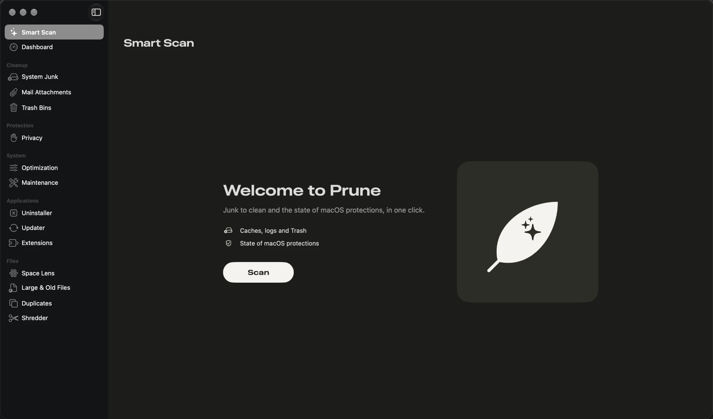

<div align="center">

# 🌿 Prune

### Your Mac, lighter. Cleaner. Safer.

Clean junk, uninstall apps completely, protect your privacy and keep an eye on your Mac — all in one beautiful, native app. **Free and open source.**

<a href="https://github.com/viniciuslopesgit/prune/releases/latest"></a>


<br>



<sub>English and Portuguese · follows your system language · nothing is deleted without your confirmation</sub>

</div>

## Get started in 30 seconds

1. **[Download Prune](https://github.com/viniciuslopesgit/prune/releases/latest)** and drag it to Applications.
2. Open it and allow it once (see below).
3. Click **Scan**. That's it — review what was found and clean in one click.

## Install

1. Open `Prune-<version>.dmg` and drag Prune to **Applications**.
2. On first launch, macOS blocks the app because Prune is not registered with Apple. Allow it once in *System Settings ▸ Privacy & Security ▸ Open Anyway*, or in Terminal:
   ```bash
   xattr -dr com.apple.quarantine /Applications/Prune.app
   ```
3. Follow the assistant to grant **Full Disk Access**.

To update, download the new version and replace the app in Applications. What's new is in the [CHANGELOG](CHANGELOG.md).

## Features

- **Smart Scan:** junk to clean and the state of macOS protections, in one click.
- **Dashboard:** disk, memory, CPU, network, battery and macOS protections (SIP, Gatekeeper, Firewall, FileVault, XProtect).
- **Cleanup:** caches, logs, temporary files, Xcode and package managers, iPhone files, Mail attachments and Trash.
- **Privacy:** history, cookies and caches of Safari, Chrome, Edge, Brave, Opera, Vivaldi, Arc and Firefox. Passwords and bookmarks stay intact.
- **System:** login items, processes and maintenance tasks (DNS, Spotlight, Launch Services, disk).
- **Applications:** complete uninstallation, leftovers of removed apps, updates (Sparkle and Homebrew) and extensions.
- **Files:** disk map, large and old files, duplicates, similar photos and secure shredding.
- **Menu bar:** CPU, memory, disk, network and battery in real time.

The interface is shown in English or Portuguese, depending on the language of your Mac.

## Security and privacy

- Nothing is deleted without confirmation. You can review each item before cleaning.
- System folders and personal folders are protected, whatever you select.
- Personal files and apps go to the Trash. Caches and logs are deleted directly. You can change this in Settings.
- Usage statistics are anonymous and only sent with your consent. They never include names of files, folders or apps.

## Development

Requires macOS 12 or later and the Xcode Command Line Tools (`xcode-select --install`).

```bash
./scripts/setup_signing.sh   # once: local certificate, so macOS keeps the permissions
./scripts/build_app.sh       # creates build/Prune.app (universal)
./scripts/install.sh         # builds and updates /Applications/Prune.app
./scripts/make_dmg.sh        # creates build/Prune-<version>.dmg
```

The code and its texts are in English. Translations live in `Resources/<language>.lproj/Localizable.strings`, keyed by the English text; `scripts/check_localization.py` checks that every text is translated.

### Tests and publishing

Work in progress, the automated tests and version publishing are on the [`dev`](https://github.com/viniciuslopesgit/prune/tree/dev) branch (see [docs/development.md](https://github.com/viniciuslopesgit/prune/blob/dev/docs/development.md)). `main` only has what is needed to build the stable version.

When a version becomes stable: [release criteria](https://github.com/viniciuslopesgit/prune/blob/dev/docs/RELEASE_CRITERIA.md). How to contribute: [CONTRIBUTING.md](CONTRIBUTING.md). Vulnerabilities: [SECURITY.md](SECURITY.md).

### Versions

`main` is the stable version (chosen and verified automatically on `dev`) and `dev` is the work in progress. Each version has a `vX.Y.Z` tag and a [Release](https://github.com/viniciuslopesgit/prune/releases) with the DMG and `SHA256SUMS`: it comes out as a beta (pre-release) and becomes **Latest** when it is promoted to stable.

## License

[GPL-3.0](LICENSE)
